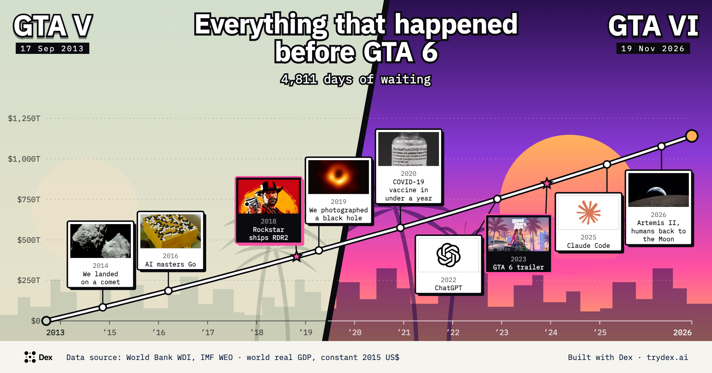
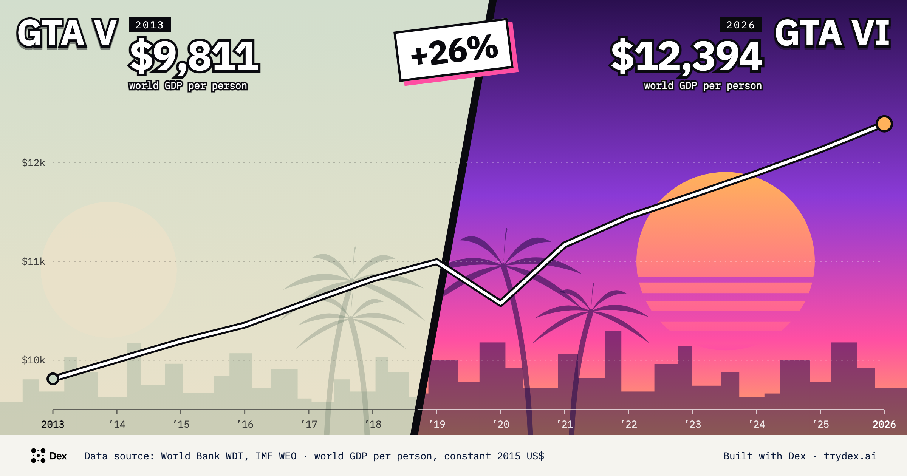
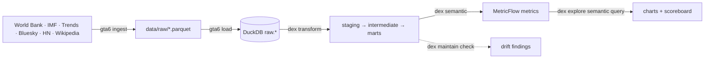

# GTA 6 vs. Productivity

<picture>
  <source media="(prefers-color-scheme: dark)" srcset="https://raw.githubusercontent.com/exmergo/gta6-productivity-impact/1a60cf5c025f12f24037ad4c1cd53d9ff60e9e26/charts/png/everything-we-made-dark.png">
  
</picture>

**Between GTA 5 and GTA 6, humanity made $1.14 quadrillion of stuff.** 4,811 days. We landed
on a comet, photographed a black hole and caught a spaceship. Now we play GTA.

An open, reproducible study, built with **[Dex](https://github.com/exmergo/dex)** on dbt and a
semantic layer.  
Live scoreboard, with a ticker that stops at GTA 6: **[exmergo.github.io/gta6-productivity-impact](https://exmergo.github.io/gta6-productivity-impact/)**

## Everything we made while waiting

GTA 5 came out on 17 September 2013. GTA 6 unlocks at 00:00 UTC on Thursday 19 November 2026.
In between, the world made this much, in real terms:

| GTA 5 to GTA 6 | |
|---|---|
| Made (world real GDP, constant 2015 US$) | **$1.14 quadrillion** |
| Days waited | 4,811 (17 Sep 2013 to 18 Nov 2026) |
| Per day, in 2026 | $282 billion |
| Per second, in 2026 | $3.3 million |

And what we did with the time, with what the world had made since GTA 5 by the day before:

| Date | Meanwhile, humanity… | Made since GTA 5 |
|---|---|---|
| 12 Nov 2014 | landed on a comet | $84T |
| 10 Apr 2019 | photographed a black hole | $435T |
| 8 Dec 2020 | gave the first COVID vaccine shot outside a trial (halfway through the wait's output) | $575T |
| 30 Nov 2022 | met ChatGPT | $752T |
| 4 Dec 2023 | watched GTA 6 Trailer 1 | $847T |
| 14 Nov 2026 | caught a spaceship, 5 days before GTA 6 | $1,140T |

By the first GTA 6 trailer, 74% of the wait's output was already made. Fans then waited out the
last $294T.

World Bank world GDP, each year spread evenly over its days; 2026 is the World Bank's 2025 figure
grown by the IMF's 2026 world growth forecast. Each milestone has one public source; all 46 are
on the [scoreboard](https://exmergo.github.io/gta6-productivity-impact/).
Details in [docs/metrics.md](docs/metrics.md#3-everything-humanity-made-while-waiting).

It didn't just make more because there were more of us. Each person made more, too.

## The streak: GTA 5 to GTA 6

<picture>
  <source media="(prefers-color-scheme: dark)" srcset="https://raw.githubusercontent.com/exmergo/gta6-productivity-impact/1f235b8e7a86f2839c966f5a73e7828dea522abc/charts/png/gta-v-to-gta-6-dark.png">
  
</picture>

**Between GTA 5 and GTA 6, the world got 26% more productive.** Thirteen years, two delays and
one record-breaking trailer later, the world's real output per person grew by a quarter, and it
fell only once: in 2020.

| World, real terms | 2013 (GTA 5) | Latest | Change |
|---|---|---|---|
| GDP per person | $9,811 | $12,394 (2026) | **+26%** |
| GDP per worker | $40,581 | $50,672 (2025) | **+25%** |

World Bank WDI. 2026 is the World Bank's 2025 figure grown by the IMF's 2026 world growth
forecast. Details in [docs/metrics.md](docs/metrics.md#2-gta-5-to-gta-6).

GTA 6 comes out on **Thursday 19 November 2026**. Is it the combo breaker?

## The combo breaker: people are already planning the day off

<picture>
  <source media="(prefers-color-scheme: dark)" srcset="https://raw.githubusercontent.com/exmergo/gta6-productivity-impact/e5d0db84f376b56b2472d936ac408e9b14640f95/charts/png/day-off-index-dark.png">
  
</picture>

Nobody publishes how many people booked that Thursday off. Somewhere, a calendar now reads
"dentist (GTA)". So we measured what people *search* for when they're planning to skip work,
against the same weeks last year.

**The Day-Off Index: +50%.** US Google searches for skipping work, 1–14 Nov 2026 against
2–15 Nov 2025:

| Search (US) | 2025 | 2026 | Change |
|---|---|---|---|
| "day off work" | 54.5 | 94.5 | **+73%** |
| "call in sick" | 68.0 | 95.5 | **+40%** |
| "sick day" | 70.0 | 95.5 | **+36%** |
| **Day-Off Index** (average) | | | **+50%** |

Weekly Google Trends interest (0–100), one request per phrase covering both years, so both
years sit on one scale.

Whether the streak actually breaks shows up after release: GitHub pull requests, Wikipedia
edits and the recovery curve are next in [the series](#the-series). Every number in this repo
comes out of a dbt project and a semantic layer that [Dex](https://trydex.ai) wrote, tested
and checks every day. The joke is GTA. The method is real.

## How we measured a vibe

The **Day-Off Index** is the average year-over-year change in US Google searches for "call
in sick", "sick day" and "day off work". Each phrase's change compares its average weekly
search interest over a window (canonical: the two Google weeks of 1–14 Nov 2026) with the
same weeks a year earlier. The window is configurable: start week, end week or number of
weeks. The index is always shown with its breakdown.

Supporting numbers, outside the index: the GTA share of Bluesky day-off talk, Wikipedia
readers of the GTA 6 article, and Hacker News (334 day-off posts in 107 days, so it's in
here for the joke). Full method: [docs/methodology.md](docs/methodology.md). Sources and
what we tried and dropped: [docs/sources.md](docs/sources.md).

**Two honest limits.**

1. This is search interest, not a headcount. People who quietly book PTO in an HR system
   don't search for it. For an outside reference, [BambooHR saw time-off requests for 19 November
   up 9–17%](https://www.bamboohr.com/resources/data-at-work/data-stories/gta-pto) on its own
   platform. That's their data, not ours.
2. Google samples. Two pulls of the same Trends request differ by a point or two, so the
   published numbers come from one pinned pull (`day_off_index_batch` in `dbt_project.yml`),
   committed in `data/raw/trends/`.

## FAQ

**How much did the world produce between GTA 5 and GTA 6?**
About $1.14 quadrillion of goods and services in real terms (constant 2015 US$), over the 4,811
days from GTA 5's release (17 September 2013) to the day before GTA 6 (18 November 2026). In
2026 the world makes about $3.3 million a second, or $282 billion a day.

**Is that in today's dollars?**
No. It's real output at 2015 prices, so years compare fairly. In today's prices the figure would
be larger. The per-second rate is a yearly average spread evenly; nobody measures GDP by the
second.

**Why these milestones?**
They're moments most people remember, not a ranking, each dated to a UTC day and
backed by one public source (`seeds/wait_milestones.csv`). Each one reads what the world had made
since GTA 5 by the day before it.

**Did the world get more productive between GTA 5 and GTA 6?**
Yes. World real GDP per person rose 26%, from $9,811 in 2013 to $12,394 in 2026 (2026 is an
estimate from the IMF's growth forecast). It rose every year except 2020.

**Are Americans searching for sick days more before GTA 6?**
Yes. US Google searches for skipping work were up 50% on average, 1–14 Nov 2026 against 2–15
Nov 2025: "day off work" +73%, "call in sick" +40%, "sick day" +36%. GTA 6 launches on
Thursday 19 November 2026.

**What is the Day-Off Index?**
The average year-over-year change in US Google searches for "call in sick", "sick day" and
"day off work", each compared over the same two weeks a year apart. It is always shown with its
breakdown.

**Did GTA 6 cause the rise?**
We can't say. The rise lines up with the run-up to GTA 6, but it's an association, not proof of
cause.

**Is this how many people are taking the day off?**
No. It's Google search interest, a 0–100 index, not a headcount.

**Can I check the numbers?**
Yes. Everything is committed: raw pulls, the DuckDB warehouse, the dbt models, the semantic
layer and every Dex command envelope. See [Ask it yourself](#ask-it-yourself).

## What Dex did here

Don't take our word for any of it: every command [Dex](https://trydex.ai) ran is committed,
with its output.

- **Explore.** Before any SQL was written, `dex explore` profiled every raw table and
  proved each grain with exact distinct counts. It caught that Wikipedia timestamps would
  shift a day in a non-UTC session, and that Hacker News was too sparse to be in the index.
  Evidence: [`.dex/review/01`–`07`](.dex/review/).
- **Transform.** Every model went through `dex transform plan` with a declaration: grain,
  population, column roles, units and the assumptions behind them. The Dex population
  guard refused one apply until a request-level assumption said why the marts drop days
  outside the study window. Plans: [`.dex/plans/`](.dex/plans/). Payloads:
  [`.dex/payloads/`](.dex/payloads/).
- **The semantic layer.** Dex drafted the MetricFlow semantic models from the declarations.
  We wrote the metrics on top: `world_output_produced`, `day_off_index`, its breakdown
  `day_off_index_term_change`, `gta_share_of_day_off_talk` and more. Every chart
  in this README is drawn from `dex explore semantic query`, never from raw SQL. If an agent
  can ask it, the chart can draw it.
- **Maintain.** `dex maintain verify` proves all declared grains (15 of 15). The baseline is
  committed in [`.dex/snapshot.json`](.dex/snapshot.json) like a lockfile, and every
  refresh runs `dex maintain check` against it.



## Ask it yourself

```bash
git clone https://github.com/exmergo/gta6-productivity-impact
cd gta6-productivity-impact
uv sync
uv run dbt parse   # compile the semantic layer once (target/ isn't committed)

# What does the layer know?
uv run dex explore semantic list

# Everything the world made while waiting, and by each milestone
uv run dex explore semantic query world_output_produced
uv run dex explore semantic query wait_milestone_output \
  --group-by milestone__title,milestone__event_date

# The headline, always with its breakdown
uv run dex explore semantic query day_off_index --group-by day_off_index_window__breakdown
uv run dex explore semantic query day_off_index_term_change,day_off_index_term_prior,day_off_index_term_current \
  --group-by day_off_index_term__term

# The lead-up, by day and source
uv run dex explore semantic query gta_share_of_day_off_talk \
  --group-by metric_time__day,signal_day__source
```

Or point your coding agent at the repo and ask "are people searching for sick days more than last year?".
`AGENTS.md` tells it to go through the semantic layer first.

## Reproduce in two minutes

The warehouse (`warehouse/gta6.duckdb`) and every raw pull (`data/raw/`) are committed.

```bash
uv sync
uv run gta6 refresh --offline   # rebuild from committed raw data, verify, check, redraw
uv run gta6 refresh             # pull fresh public data first (no API keys needed)
```

Charts need Chrome or Chromium for the PNG captures (`CHROME=/path/to/chrome` if it's
somewhere unusual).

To work on the models with an agent, install Dex:

```bash
# Claude Code
/plugin marketplace add exmergo/exmergo-agent-plugins
/plugin install dex@exmergo

# Any other agent (the skills are also vendored in .agents/skills/)
npx skills add exmergo/dex
```

## The series

The streak holds or breaks over the next two weeks, one metric at a time:

| # | Metric | Question | When |
|---|---|---|---|
| 1 | **Day-Off Index** | Are people searching for ways to skip work more than last year? | live |
| 2 | **GTA 5 to GTA 6** | How much more productive did the world get between the two launches? | live |
| 3 | **Everything humanity made while waiting** | How much did the world make between GTA 5 and GTA 6? | **live, Thu 19 Nov (release day)** |
| 4 | **PRs opened on GitHub** | Did GitHub go quiet on Thursday? | Fri 20 Nov |
| 5 | **Wikipedia brain drain** | Did the world stop editing the encyclopaedia? | after release |
| 6 | **The recovery curve** | How many working days until output is back to normal? | 30 Nov |

Details in [docs/metrics.md](docs/metrics.md).

## License

Apache-2.0. See [LICENSE](LICENSE) and [NOTICE](NOTICE). Not affiliated with or endorsed by
Rockstar Games or Take-Two Interactive. Go play the game. We'll count.
