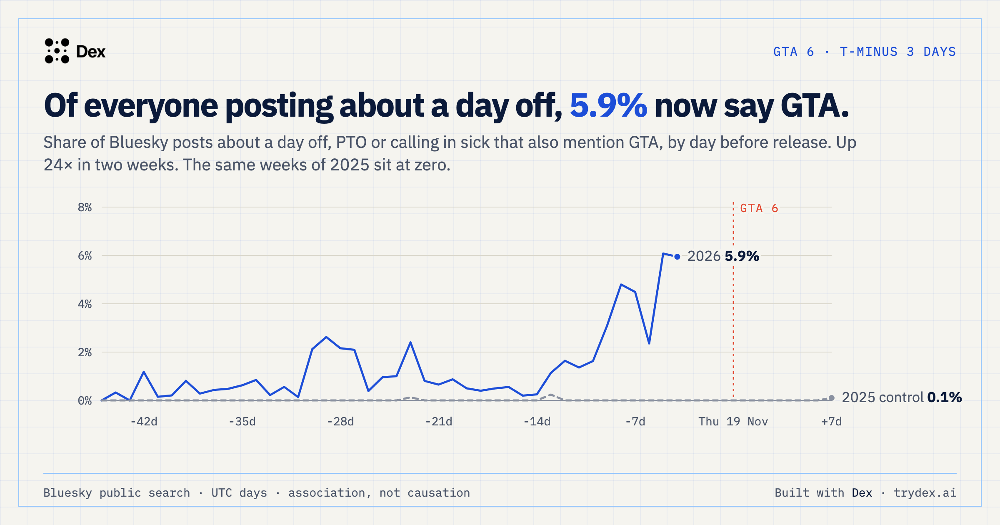
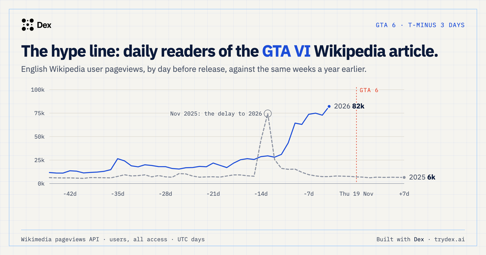
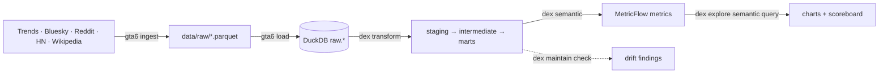

# GTA 6 vs. Productivity

<picture>
  <source media="(prefers-color-scheme: dark)" srcset="charts/png/day-off-index-dark.png">
  
</picture>

**GTA 6 comes out on Thursday 19 November 2026.** Twelve years after GTA V. Two delays. One
trailer that broke YouTube's record for a game reveal. Somewhere, a calendar now reads
"dentist (GTA)".

Nobody publishes how many people booked that Thursday off. So we measured what people
*search* and *say*, and compared Thursday with the Thursday before. Every number in this
repo comes out of a dbt project and a semantic layer that [Dex](https://trydex.ai) wrote,
tested and checks every day. The joke is GTA. The method is real.

## The numbers so far

> [!NOTE]
> The release Thursday hasn't happened yet. The Day-Off Index for 2026 fills in once UTC
> Thursday 19 November has closed. The refresh runs daily, plus extra runs around release.

**Of everyone posting about a day off on Bluesky, about 6% now mention GTA.** Two weeks
earlier it was a quarter of a percent. The same weeks of 2025 sit at zero.

<picture>
  <source media="(prefers-color-scheme: dark)" srcset="charts/png/gta-share-of-day-off-talk-dark.png">
  
</picture>

**The control week matters.** The same pair of Thursdays in 2025 (20 vs 13 November)
already scores **108** on the Day-Off Index. The week before Thanksgiving week runs hot
without any help from Rockstar. So the headline is the 2026 index *net of* that.

**The hype line.** Daily readers of the GTA VI Wikipedia article went from about 12k at the
start of October to over 80k. The 2025 spike is the day the game was delayed to 2026.

<picture>
  <source media="(prefers-color-scheme: dark)" srcset="charts/png/gta-wikipedia-hype-dark.png">
  
</picture>

Live scoreboard: **https://exmergo.github.io/gta6-productivity-impact/**

## How we measured a vibe

The **Day-Off Index** is the geometric mean of Thursday lifts (Thu 19 Nov over Thu 12 Nov)
across three kinds of signal, times 100. A normal week is 100.

| Signal | Source | What it counts |
|---|---|---|
| Search intent | Google Trends, US and worldwide | "call in sick", "sick day", "PTO", "day off work" |
| Posts | Bluesky public search | Posts per UTC day that say day off, PTO or calling in sick |
| Posts | Reddit, via the Arctic Shift archive | The same, in 9 subreddits from r/GTA6 to r/antiwork |

Supporting numbers: the GTA share of day-off talk, Wikipedia readers of the GTA VI
article, and Hacker News. Hacker News found 334 day-off posts in 107 days, so it's in here
for the joke. Full method: [docs/methodology.md](docs/methodology.md). Sources and what we
tried and dropped: [docs/sources.md](docs/sources.md).

**Two honest limits.**

1. This is a proxy, not a headcount. People who quietly book PTO in an HR system don't
   post about it. For an outside reference, BambooHR reportedly saw time-off requests for
   19 November up 9–17%. That's their data, not ours.
2. Search indexes move. Bluesky's `hitsTotal` and Algolia's `nbHits` are what those
   services report on the day we ask. `dex maintain check` runs on every refresh, so a
   sudden change in volume shows up as a finding before it becomes a chart.

## What Dex did here

This repo is a [Dex](https://trydex.ai) showcase, so the evidence is committed, not
summarised.

- **Explore.** Before any SQL was written, `dex explore` profiled every raw table and
  proved each grain with exact distinct counts. It caught that Wikipedia timestamps would
  shift a day in a non-UTC session, and that Hacker News was too sparse to be in the index.
  Evidence: [`.dex/review/01`–`07`](.dex/review/).
- **Transform.** Every model went through `dex transform plan` with a declaration: grain,
  population, column roles, units and the assumptions behind them. The Dex population
  guard refused one apply until a request-level assumption said why the marts drop days
  outside the study window. Plans: [`.dex/plans/`](.dex/plans/). Payloads:
  [`.dex/payloads/`](.dex/payloads/).
- **The semantic layer.** Dex drafted the MetricFlow semantic models from the declarations.
  We wrote the 12 metrics on top: `day_off_index`, `day_off_index_gta_effect` (net of
  season), `gta_share_of_day_off_talk`, `signal_value_prior_week_ratio` and more. Every chart
  in this README is drawn from `dex explore semantic query`, never from raw SQL. If an agent
  can ask it, the chart can draw it.
- **Maintain.** `dex maintain verify` proves all declared grains (10 of 10). The baseline is
  committed in [`.dex/snapshot.json`](.dex/snapshot.json) like a lockfile, and every
  refresh runs `dex maintain check` against it.



## Ask it yourself

```bash
git clone https://github.com/exmergo/gta6-productivity-impact
cd gta6-productivity-impact
uv sync

# What does the layer know?
uv run dex explore semantic list

# The headline, and the control
uv run dex explore semantic query day_off_index --group-by index_year__study_year

# The lead-up, by day and source
uv run dex explore semantic query gta_share_of_day_off_talk \
  --group-by metric_time__day,signal_day__source
```

Or point your coding agent at the repo and ask "how many people took Thursday off for GTA 6?".
`AGENTS.md` tells it to go through the semantic layer first.

## Reproduce in two minutes

The warehouse (`warehouse/gta6.duckdb`) and every raw pull (`data/raw/`) are committed.

```bash
uv sync
uv run gta6 refresh --offline   # rebuild from committed raw data, verify, check, redraw
uv run gta6 refresh             # pull fresh public data first (no API keys needed)
```

Charts need Chrome or Chromium for the PNG captures (`CHROME=/path/to/chrome` if it's
somewhere unusual).

To work on the models with an agent, install Dex:

```bash
# Claude Code
/plugin marketplace add exmergo/exmergo-agent-plugins
/plugin install dex@exmergo

# Any other agent (the skills are also vendored in .agents/skills/)
npx skills add exmergo/dex
```

## The series

| # | Metric | Question | When |
|---|---|---|---|
| 1 | **Day-Off Index** | Did people take Thursday off? | live |
| 2 | **PRs opened on GitHub** | Did GitHub go quiet on Thursday? | Fri 20 Nov |
| 3 | **Stack Overflow silence** | Did developers stop asking questions? | after release |
| 4 | **Wikipedia brain drain** | Did the world stop editing the encyclopaedia? | after release |
| 5 | **The recovery curve** | How many working days until output is back to normal? | 30 Nov |

Details in [docs/metrics.md](docs/metrics.md).

## License

Apache-2.0. See [LICENSE](LICENSE) and [NOTICE](NOTICE). Not affiliated with or endorsed by
Rockstar Games or Take-Two Interactive. Go play the game. We'll count.
