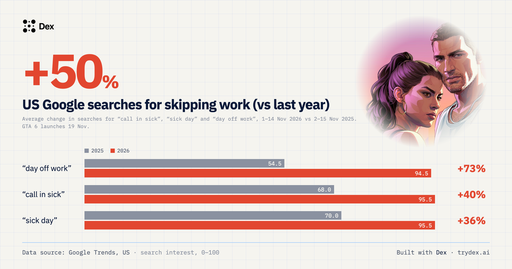
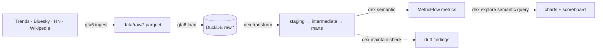

# GTA 6 vs. Productivity

Is everyone **skipping work for GTA 6?** An open, reproducible study of US Google searches for
**"call in sick", "sick day" and "day off work"**, built with **[Dex](https://github.com/exmergo/dex)** on dbt and a
semantic layer.  
Live scoreboard: **[exmergo.github.io/gta6-productivity-impact](https://exmergo.github.io/gta6-productivity-impact/)**

<picture>
  <source media="(prefers-color-scheme: dark)" srcset="https://raw.githubusercontent.com/exmergo/gta6-productivity-impact/e5d0db84f376b56b2472d936ac408e9b14640f95/charts/png/day-off-index-dark.png">
  
</picture>

**GTA 6 comes out on Thursday 19 November 2026.** Twelve years after GTA V. Two delays. One
trailer that set YouTube's 24-hour record for a non-music video. Somewhere, a calendar now reads
"dentist (GTA)".

Nobody publishes how many people booked that Thursday off. So we measured what people
*search* for when they're planning to skip work, against the same weeks last year. Every number in this
repo comes out of a dbt project and a semantic layer that [Dex](https://trydex.ai) wrote,
tested and checks every day. The joke is GTA. The method is real.

## The numbers so far

**The Day-Off Index: +50%.** US Google searches for skipping work, 1–14 Nov 2026 against
2–15 Nov 2025:

| Search (US) | 2025 | 2026 | Change |
|---|---|---|---|
| "day off work" | 54.5 | 94.5 | **+73%** |
| "call in sick" | 68.0 | 95.5 | **+40%** |
| "sick day" | 70.0 | 95.5 | **+36%** |
| **Day-Off Index** (average) | | | **+50%** |

Weekly Google Trends interest (0–100), one request per phrase covering both years, so both
years sit on one scale.

## How we measured a vibe

The **Day-Off Index** is the average year-over-year change in US Google searches for "call
in sick", "sick day" and "day off work". Each phrase's change compares its average weekly
search interest over a window (canonical: the two Google weeks of 1–14 Nov 2026) with the
same weeks a year earlier. The window is configurable: start week, end week or number of
weeks. The index is always shown with its breakdown.

Supporting numbers, outside the index: the GTA share of Bluesky day-off talk, Wikipedia
readers of the GTA VI article, and Hacker News (334 day-off posts in 107 days, so it's in
here for the joke). Full method: [docs/methodology.md](docs/methodology.md). Sources and
what we tried and dropped: [docs/sources.md](docs/sources.md).

**Two honest limits.**

1. This is search interest, not a headcount. People who quietly book PTO in an HR system
   don't search for it. For an outside reference, [BambooHR saw time-off requests for 19 November
   up 9–17%](https://www.bamboohr.com/resources/data-at-work/data-stories/gta-pto) on its own
   platform. That's their data, not ours.
2. Google samples. Two pulls of the same Trends request differ by a point or two, so the
   published numbers come from one pinned pull (`day_off_index_batch` in `dbt_project.yml`),
   committed in `data/raw/trends/`.

## FAQ

**Are Americans searching for sick days more before GTA 6?**
Yes. US Google searches for skipping work were up 50% on average, 1–14 Nov 2026 against 2–15
Nov 2025: "day off work" +73%, "call in sick" +40%, "sick day" +36%. GTA 6 launches on
Thursday 19 November 2026.

**What is the Day-Off Index?**
The average year-over-year change in US Google searches for "call in sick", "sick day" and
"day off work", each compared over the same two weeks a year apart. It is always shown with its
breakdown.

**Did GTA 6 cause the rise?**
We can't say. The rise lines up with the run-up to GTA 6, but it's an association, not proof of
cause.

**Is this how many people are taking the day off?**
No. It's Google search interest, a 0–100 index, not a headcount.

**Can I check the numbers?**
Yes. Everything is committed: raw pulls, the DuckDB warehouse, the dbt models, the semantic
layer and every Dex command envelope. See [Ask it yourself](#ask-it-yourself).

## What Dex did here

Don't take our word for any of it: every command [Dex](https://trydex.ai) ran is committed,
with its output.

- **Explore.** Before any SQL was written, `dex explore` profiled every raw table and
  proved each grain with exact distinct counts. It caught that Wikipedia timestamps would
  shift a day in a non-UTC session, and that Hacker News was too sparse to be in the index.
  Evidence: [`.dex/review/01`–`07`](.dex/review/).
- **Transform.** Every model went through `dex transform plan` with a declaration: grain,
  population, column roles, units and the assumptions behind them. The Dex population
  guard refused one apply until a request-level assumption said why the marts drop days
  outside the study window. Plans: [`.dex/plans/`](.dex/plans/). Payloads:
  [`.dex/payloads/`](.dex/payloads/).
- **The semantic layer.** Dex drafted the MetricFlow semantic models from the declarations.
  We wrote the metrics on top: `day_off_index`, its breakdown `day_off_index_term_change`,
  `gta_share_of_day_off_talk` and more. Every chart
  in this README is drawn from `dex explore semantic query`, never from raw SQL. If an agent
  can ask it, the chart can draw it.
- **Maintain.** `dex maintain verify` proves all declared grains (10 of 10). The baseline is
  committed in [`.dex/snapshot.json`](.dex/snapshot.json) like a lockfile, and every
  refresh runs `dex maintain check` against it.



## Ask it yourself

```bash
git clone https://github.com/exmergo/gta6-productivity-impact
cd gta6-productivity-impact
uv sync
uv run dbt parse   # compile the semantic layer once (target/ isn't committed)

# What does the layer know?
uv run dex explore semantic list

# The headline, always with its breakdown
uv run dex explore semantic query day_off_index --group-by day_off_index_window__breakdown
uv run dex explore semantic query day_off_index_term_change,day_off_index_term_prior,day_off_index_term_current \
  --group-by day_off_index_term__term

# The lead-up, by day and source
uv run dex explore semantic query gta_share_of_day_off_talk \
  --group-by metric_time__day,signal_day__source
```

Or point your coding agent at the repo and ask "are people searching for sick days more than last year?".
`AGENTS.md` tells it to go through the semantic layer first.

## Reproduce in two minutes

The warehouse (`warehouse/gta6.duckdb`) and every raw pull (`data/raw/`) are committed.

```bash
uv sync
uv run gta6 refresh --offline   # rebuild from committed raw data, verify, check, redraw
uv run gta6 refresh             # pull fresh public data first (no API keys needed)
```

Charts need Chrome or Chromium for the PNG captures (`CHROME=/path/to/chrome` if it's
somewhere unusual).

To work on the models with an agent, install Dex:

```bash
# Claude Code
/plugin marketplace add exmergo/exmergo-agent-plugins
/plugin install dex@exmergo

# Any other agent (the skills are also vendored in .agents/skills/)
npx skills add exmergo/dex
```

## The series

| # | Metric | Question | When |
|---|---|---|---|
| 1 | **Day-Off Index** | Are people searching for ways to skip work more than last year? | live |
| 2 | **PRs opened on GitHub** | Did GitHub go quiet on Thursday? | Fri 20 Nov |
| 3 | **Stack Overflow silence** | Did developers stop asking questions? | after release |
| 4 | **Wikipedia brain drain** | Did the world stop editing the encyclopaedia? | after release |
| 5 | **The recovery curve** | How many working days until output is back to normal? | 30 Nov |

Details in [docs/metrics.md](docs/metrics.md).

## License

Apache-2.0. See [LICENSE](LICENSE) and [NOTICE](NOTICE). Not affiliated with or endorsed by
Rockstar Games or Take-Two Interactive. Go play the game. We'll count.
